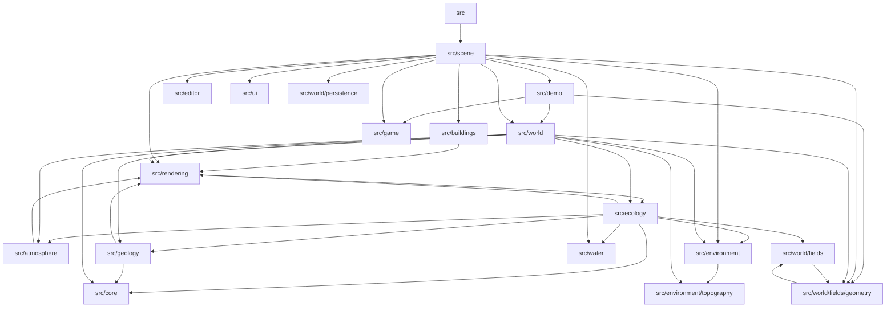

# Somnium — Dependency Graph

Automatically generated from relative JavaScript imports.

The direction of each arrow is:

`Importing directory --> Imported directory`

## Dependency Statistics

- JavaScript files analyzed: 128
- Source directories analyzed: 19
- Cross-directory dependency relationships: 38

## Limitations

- Only statically identifiable relative imports are included.
- External dependencies are excluded.
- Runtime service relationships are not inferred.
- This graph represents source dependencies, not execution order.
